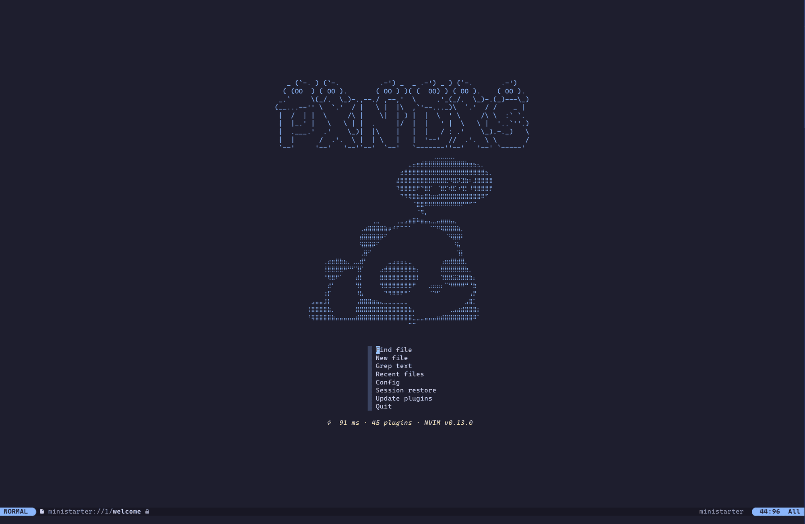
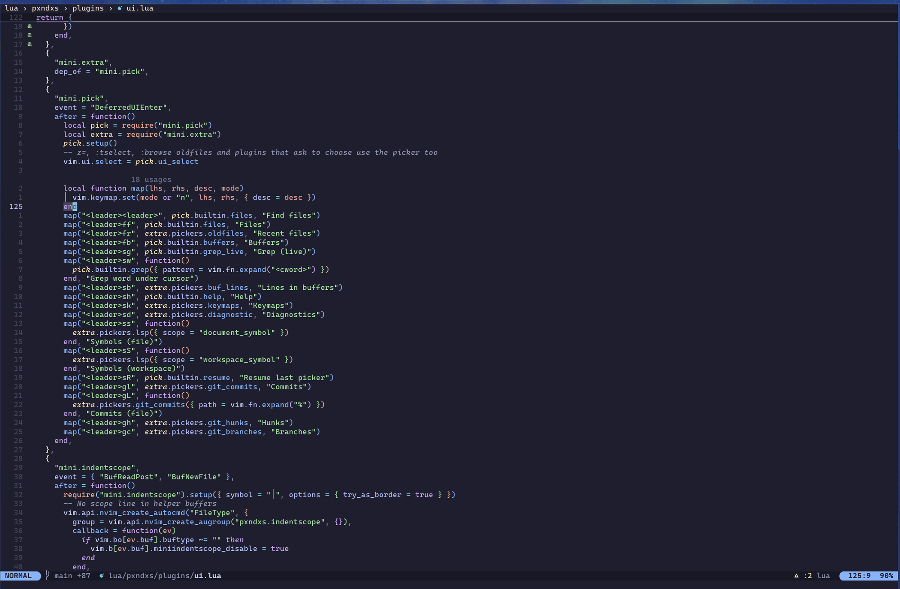

# neopanda 🐼

[English](README.md) · **Español**

> Traducción de [README.md](README.md), que es la referencia: si algo difiere, vale la versión en inglés.

Una config de Neovim **nightly (0.13)** que usa lo que Neovim ya trae — cliente LSP, completado, snippets,
treesitter, statusline, sesiones, multicursor — y añade un plugin solo donde no hay nada nativo. Los plugins los
instala `vim.pack` (integrado) y se cargan bajo demanda con [lze](https://github.com/BirdeeHub/lze); los servidores
LSP se configuran sin nvim-lspconfig. Los atajos están pensados para **Dvorak** en un teclado 60 %.

Corre como app propia (`NVIM_APPNAME=neopanda`), así que nunca toca un `~/.config/nvim` existente.
Se abre con `npd` (o `neopanda`).





> [!NOTE]
> Solo nightly: usa APIs de 0.13 (`vim.pack`, ui2, multicursor nativo, `:restart`). En una versión estable no carga.

## Funcionalidades

- **Edición** — multicursor nativo, surround, pares, saltos con flash, text objects de treesitter y split/join,
  buscar y reemplazar en el proyecto (grug-far), gestión de archivos editando un directorio (oil).
- **Buscar** — mini.pick para archivos, grep, buffers, ayuda, atajos, símbolos LSP y diagnósticos; también
  `vim.ui.select`.
- **LSP** — 23 servidores en `lsp/*.lua`, activos solo si están instalados; formateo al guardar vía el servidor;
  inlay hints, code lens, folding, resaltado de referencias; schemas para JSON/YAML.
- **Completado** — menú nativo mientras escribes, firma encima del cursor, friendly-snippets + tus `snippets/`.
- **UI** — tema michipanda, selector de temas con vista previa, transparencia, flotantes de cristal, statusline, statuscolumn y breadcrumbs nativos, mensajes ui2, render-markdown, indent scope.
- **Git** — gitsigns (hunks, blame, diff por palabra), lazygit flotante, pickers de commits y ramas, abrir en GitHub.
- **IA** — texto fantasma de Copilot y sugerencias de siguiente edición vía el cliente LSP nativo, Claude Code
  conectado como su extensión de IDE, otras CLIs de IA (opencode, codex…) en una terminal lateral.
- **Depuración y tests** — nvim-dap + dap-view (JS/TS, Go, Rust, Dart), `.vscode/launch.json`; neotest (Go, Vitest,
  Dart), Rust con `cargo test`.
- **Lenguajes** — bases de datos (dadbod), peticiones HTTP (`.hurl`), versiones en `Cargo.toml`, Docker, SQL.
- **Sesiones** — una por directorio (y rama de git), se restaura al abrir `npd` sin archivo; sin sesión, una
  pantalla de inicio (mini.starter) muestra el panda y un menú de una tecla.

## Instalación

### Nix (macOS / NixOS / Linux)

Sin clonar. Pruébalo sin instalar:

```sh
nix run github:pxnditxyr/neopanda
```

O añade el flake a tu config y haz rebuild:

```nix
# flake.nix
inputs.neopanda.url = "github:pxnditxyr/neopanda";

# home-manager (o environment.systemPackages)
home.packages = [ inputs.neopanda.packages.${pkgs.stdenv.hostPlatform.system}.default ];
```

Luego abre `npd`. En el primer arranque descarga los plugins y compila los parsers por sí solo, cerca de un minuto y sin
preguntas, así que necesita red una vez. Si no puede descargarlos, lo reintenta en el siguiente arranque.

El wrapper `npd` pone en el `PATH` todo lo que la config necesita: git, ripgrep, fd, lazygit, tree-sitter, los
servidores LSP (incluido el de Copilot, el único paquete no libre), adaptadores de depuración, hurl, jq y clientes
de bases de datos. La config también va dentro de `npd`, de solo lectura en el store de Nix; el lockfile de los plugins
es una copia escribible en `~/.local/state/neopanda`.

Para cambiar la config, clona el repo y apunta `npd` a él. Los cambios en Lua se aplican en el siguiente arranque, sin
rebuild, y `:packupdate` escribe el lockfile del repo:

```sh
NEOPANDA_CONFIG=~/dev/neopanda npd
```

### Ubuntu / WSL2 (sin Nix)

```sh
git clone https://github.com/pxnditxyr/neopanda ~/dev/neopanda
~/dev/neopanda/scripts/bootstrap.sh --dry-run   # vista previa
~/dev/neopanda/scripts/bootstrap.sh
```

Se puede ejecutar varias veces. El script:

- instala `git ripgrep fd-find build-essential curl unzip xz-utils xclip inotify-tools python3-venv libxml2 jq
  postgresql-client sqlite3 mariadb-client` con apt y enlaza `fd` → `fdfind`;
- instala [bob](https://github.com/MordechaiHadad/bob) desde una release con checksum verificado, y luego Neovim
  nightly;
- instala tree-sitter, lazygit y hurl desde releases con checksum verificado en `~/.local/bin`, y Claude Code con su
  instalador oficial;
- mantiene Node 22+ si ya está, si no instala Node 26 con checksum verificado en `~/.local` (Mason lo necesita);
- mueve un `~/.config/neopanda` existente (y sus datos, estado y caché) a `*.bak.<timestamp>`;
- enlaza `~/.config/neopanda` al clon;
- añade `PATH` y `alias npd='NVIM_APPNAME=neopanda nvim'` a `~/.bashrc` / `~/.zshrc`.

En el primer arranque, Mason instala los servidores LSP y los adaptadores de depuración (`:Mason` para verlo, `ZR`
al terminar). No están en Mason: nixd (solo Nix) y rust-analyzer (`rustup component add rust-analyzer`). En WSL2 el
portapapeles funciona vía WSLg con `xclip`.

### Desinstalar

```sh
rm -rf ~/.config/neopanda ~/.local/share/neopanda ~/.local/state/neopanda ~/.cache/neopanda
```

Después quita el bloque `# neopanda` de tu rc de shell (bootstrap) o el paquete de tu config de Nix.

## Uso

El leader es `<Space>`; `<Space>` solo espera y muestra las teclas siguientes (mini.clue). Solo se listan los atajos
que nightly no trae ya: `gr*` (LSP), `]d` `]q` `]b`…, `an`/`in`, `al`/`il`, `gc` (comentar), `K` y `ZR` son
nativos.

### General

| Tecla | Descripción | Modo |
|---|---|---|
| `<Esc>` | Quitar el resaltado de búsqueda | n |
| `n` / `N` | Coincidencia siguiente / anterior, centrada | n |
| `J` | Unir líneas sin mover el cursor | n |
| `<` / `>` | Indentar manteniendo la selección | x |
| `<A-j>` / `<A-k>` | Mover línea / selección abajo / arriba | n x |
| `[<Space>` / `]<Space>` | Añadir una línea vacía arriba / abajo | n |
| `gs` / `gS` | Palabra mal escrita siguiente / anterior | n x o |
| `<leader>w` / `<leader>z` | Guardar / cerrar ventana | n |
| `<C-h>` `<C-j>` `<C-k>` | Ventana izquierda / abajo / arriba (`<C-l>` sigue nativo: redibuja, quita multicursores) | n |
| `<C-Flechas>` | Redimensionar ventana | n |
| `<leader><Tab>n` | Pestaña nueva (`gt` / `gT` para cambiar) | n |
| `<leader>uu` | Mostrar / ocultar undotree | n |
| `<leader>ud` / `<leader>uv` | Activar / desactivar diagnósticos / líneas virtuales de diagnóstico | n |
| `<leader>uc` | Elegir tema: al moverte se previsualiza, `<CR>` lo deja, `<Esc>` vuelve al anterior | n |
| `<leader>uT` | Activar / desactivar transparencia | n |
| `<leader>ug` | Activar / desactivar flotantes de cristal (sin fondo) | n |
| `<C-q>` | Salir de una terminal (Claude, lazygit, `:terminal`) a la ventana anterior | t |

Multicursor nativo: `Q` añade o quita un cursor, `zq{movimiento}` pone uno en cada destino (`zqgn` = cada
coincidencia), `<C-l>` los quita y `gQ` los restaura. Otros comandos nativos: `:Undotree`,
`:DiffTool {izq} {der}` (archivos o directorios), `:Cfilter`, `ZR` (reinicia manteniendo la sesión).

### Edición

| Tecla | Descripción | Modo |
|---|---|---|
| `ys{mov}{car}` / `yss` / `S` | Surround: añadir alrededor de un movimiento / la línea / la selección | n / n / x |
| `ds{car}` / `cs{viejo}{nuevo}` | Surround: borrar / reemplazar | n |
| `s` / `S` | Salto flash / selección treesitter (`r` en operator-pending: remoto) | n x o / n o |
| `af` `ac` `aa` (e `i…`) | Text objects de función / clase / argumento (treesitter) | x o |
| `]f` `[f` `]a` `[a` (`]F` `]A`…) | Inicio (fin) de la función o argumento siguiente / anterior | n x o |
| `ai` / `ii` | Text object del bloque de indentación (con / sin borde) | x o |
| `<leader>j` | Dividir / unir el nodo bajo el cursor (treesj) | n |
| `-` / `_` | Directorio padre (navegador nativo) / editarlo con oil: renombrar, crear, borrar | n |
| `<leader>sr` | Buscar y reemplazar en el proyecto (grug-far) | n x |
| `<C-t>` / `<C-d>` | Snippet: campo siguiente / anterior (fuera de un snippet: indentar / desindentar nativo) | i s |

mini.ai añade además objetos `a`/`i` para paréntesis, comillas, etiquetas y `?` que alcanzan la siguiente
coincidencia. Se resaltan `TODO` `FIXME` `HACK` `NOTE` y los colores `#rrggbb`.

### Buscar

| Tecla | Descripción | Modo |
|---|---|---|
| `<leader><leader>` / `<leader>ff` | Buscar archivos | n |
| `<leader>fr` / `<leader>fb` | Archivos recientes / buffers | n |
| `<leader>sg` / `<leader>sw` / `<leader>sb` | Grep en vivo / palabra bajo el cursor / líneas en buffers | n |
| `<leader>ss` / `<leader>sS` | Símbolos LSP del archivo / del workspace | n |
| `<leader>sd` / `<leader>sh` / `<leader>sk` | Diagnósticos / ayuda / atajos | n |
| `<leader>sR` | Retomar el último picker | n |

### LSP, formateo y completado

Las configs de servidor están en `lsp/*.lua` y solo se activan si su binario está en el `PATH`: emmylua_ls, nixd,
vtsls, basedpyright, ruff, bashls, jsonls, yamlls, taplo, marksman, rust_analyzer, gopls, vue_ls, svelte, astro,
html, cssls, tailwindcss, eslint, biome, sqls, docker_language_server y copilot. tailwindcss, eslint, biome y sqls
solo arrancan en proyectos que los usan. Dart/Flutter: flutter-tools.nvim arranca dartls desde el SDK de Flutter.

| Tecla | Descripción | Modo |
|---|---|---|
| `gd` / `gD` | Definición / declaración | n |
| `gra` `grn` `grr` `gri` `grt` `gO` `K` | Nativos: code action, renombrar, referencias, implementación, tipo, símbolos, hover | n |
| `<C-s>` | Ayuda de firma | i |
| `<C-y>` / `<C-e>` | Aceptar / cancelar el menú de completado | i |
| `<leader>uf` / `<leader>uF` | Activar / desactivar formateo al guardar (todo / este buffer) | n |
| `<leader>uh` | Activar / desactivar inlay hints | n |
| `<leader>uS` | Mostrar / ocultar snippets en el menú de completado | n |
| `<leader>lr` / `<leader>li` | Reiniciar los servidores / info (`:checkhealth vim.lsp`) | n |

El menú se abre mientras escribes (también con `:`, `/` y `?`); a los servidores se les pregunta tras una letra o uno
de sus caracteres de disparo. La firma aparece encima del cursor tras `(` y `,` y se queda mientras el cursor esté
dentro de la llamada. Los snippets vienen de friendly-snippets y de `snippets/` (JSON de VS Code, un archivo por
lenguaje), ordenados con el resto. Al guardar se formatea con el servidor del buffer (biome si el proyecto tiene
`biome.json`); Markdown no se formatea.

### Git

gitsigns marca las líneas cambiadas a la derecha de los números y rellena el hueco de git de la statusline. lazygit
corre en una terminal flotante: `e` sobre un archivo lo abre en este Neovim. `]c` / `[c` saltan entre cambios en
modo diff.

<details>
<summary>Atajos de git</summary>

| Tecla | Descripción | Modo |
|---|---|---|
| `]h` / `[h` / `]H` / `[H` | Hunk siguiente / anterior / último / primero (`ih`: text object de hunk) | n |
| `<leader>gs` / `<leader>gr` | Stage (alternar) / reset del hunk o de las líneas seleccionadas | n x |
| `<leader>gS` / `<leader>gR` | Stage / reset del buffer | n |
| `<leader>gp` / `<leader>gd` | Vista previa del hunk / diff de este archivo | n |
| `<leader>gb` | Blame de la línea | n |
| `<leader>ub` / `<leader>uw` | Activar / desactivar blame de línea / diff por palabra | n |
| `<leader>gg` | lazygit | n |
| `<leader>gl` / `<leader>gL` / `<leader>gh` / `<leader>gc` | Elegir commits / commits del archivo / hunks / ramas | n |
| `<leader>go` | Abrir el archivo (línea o selección) en GitHub / GitLab | n x |

</details>

### IA

| Tecla | Descripción | Modo |
|---|---|---|
| `<Tab>` | Aceptar la sugerencia (si no, campo de snippet siguiente; si no, Tab) | i |
| `<Tab>` | Saltar a / aplicar la sugerencia de siguiente edición (NES) | n |
| `<M-n>` / `<M-p>` | Sugerencia siguiente / anterior | i |
| `<leader>ua` | Activar / desactivar sugerencias | n |
| `<leader>cc` / `<leader>cf` / `<leader>cm` | Claude Code: mostrar / enfocar / modelo | n |
| `<leader>cs` | Claude Code: añadir el archivo / enviar la selección | n / x |
| `<leader>cy` / `<leader>cn` | Claude Code: aceptar / rechazar el diff propuesto (también `:w` / `:q`) | n |
| `<leader>aa` / `<leader>as` | CLI de IA: mostrar / elegir herramienta | n |
| `<leader>at` / `<leader>af` / `<leader>ap` | CLI de IA: enviar esto (línea o selección) / el archivo / un prompt | n x / n / n x |
| `<C-.>` | CLI de IA: enfocar | n x i t |

#### IA: uso

- **Inicia sesión una vez** en Copilot con `:LspCopilotSignIn`. Sin Nix, Mason instala `copilot-language-server`.
- **Texto fantasma** — escribe; aparece una sugerencia en gris. `<Tab>` la acepta, `<M-n>` / `<M-p>` recorren las
  alternativas, sigue escribiendo para ignorarla. `<leader>ua` desactiva las sugerencias (por ejemplo en una charla).
- **Siguiente edición** — tras cambiar algo, sal del modo Insert: si Copilot predice la siguiente edición en otro
  sitio, `<Tab>` en modo Normal salta ahí; `<Tab>` otra vez la aplica.
- **Claude Code** — `<leader>cc` abre Claude en una terminal lateral, conectado como su extensión de VS Code.
  Selecciona código y `<leader>cs` para enviarlo ("explica esto", "añade tests para esto"). Cuando Claude edita un
  archivo, el cambio se abre como diff: `<leader>cy` (o `:w`) acepta, `<leader>cn` (o `:q`) rechaza. `claude` +
  `/ide` en otra terminal del mismo proyecto también se conecta. `<C-q>` sale de la terminal, `<leader>cf` vuelve.
- **Otras CLIs de IA** — `<leader>as` elige una (opencode, codex…); `<leader>at` envía la línea o selección,
  `<leader>af` el archivo, `<leader>ap` un prompt preparado (revisar, arreglar diagnósticos…); `<C-.>` la enfoca.
- **Privacidad** — los archivos secretos (`.env*`, `*.pem`, `*.key`, `id_*`, `secrets.*`, `.netrc`, `credentials*`)
  nunca reciben sugerencias.

### Depuración y tests

nvim-dap es el cliente de depuración; nvim-dap-view abre un panel (scopes, watches, breakpoints, hilos, REPL,
consola) al iniciar una sesión y muestra los valores de las variables en línea. Adaptadores: JS/TS
(vscode-js-debug), Go (delve), Rust (lldb-dap, si no codelldb) y Dart/Flutter (flutter-tools). El
`.vscode/launch.json` del proyecto aparece en `<leader>dc`. neotest ejecuta tests de Go, Vitest y Dart con ✓/✗ junto
a cada uno; los tests de Rust ejecutan `cargo test` hacia la lista quickfix.

<details>
<summary>Atajos de depuración y tests</summary>

| Tecla | Descripción | Modo |
|---|---|---|
| `<leader>db` / `<leader>dB` | Breakpoint / breakpoint condicional | n |
| `<leader>dc` / `<leader>dC` | Iniciar o continuar / ejecutar hasta el cursor | n |
| `<leader>di` / `<leader>dO` / `<leader>do` | Step into / over / out | n |
| `<leader>dl` / `<leader>dt` | Repetir la última / terminar | n |
| `<leader>du` / `<leader>dr` | Mostrar la vista de depuración / REPL | n |
| `<leader>de` / `<leader>dw` | Evaluar bajo el cursor / añadir a watches | n / n x |
| `<leader>tr` / `<leader>tt` / `<leader>tT` / `<leader>tl` | Test más cercano / archivo / todos / último | n |
| `<leader>td` / `<leader>tS` / `<leader>tw` | Depurar el test más cercano / parar / vigilar el archivo | n |
| `<leader>ts` / `<leader>to` / `<leader>tO` | Resumen / salida / panel de salida | n |

</details>

### Lenguajes

| Tecla | Descripción | Modo |
|---|---|---|
| `<leader>D` | Interfaz de bases de datos (dadbod) | n |
| `<leader>rs` | `.hurl`: ejecutar la petición bajo el cursor (o la selección) | n x |
| `<leader>ra` / `<leader>rv` | `.hurl`: ejecutar todo el archivo / modo verbose | n |
| `<leader>rm` / `<leader>re` | `.hurl`: alternar respuesta en split / popup, elegir archivo de entorno | n |

Bases de datos: en el panel DBUI añade una conexión con `A` (`postgres://user@localhost/db`, `sqlite:path/app.db`);
en sus buffers de consulta el menú de completado lista primero las tablas y columnas. HTTP: la respuesta del `.hurl`
se abre en un split (`q` cierra), el JSON formateado con `jq`, variables desde un `vars.env`. `Cargo.toml` muestra
versiones, features y actualizaciones con crates.nvim (completado, hover, `gra`); en `go.mod`, el code lens de gopls
busca actualizaciones. Dockerfile, Compose y Bake usan docker-language-server.

### Sesiones

| Tecla | Descripción | Modo |
|---|---|---|
| `<leader>qs` / `<leader>qS` / `<leader>ql` | Restaurar (este directorio) / elegir / la última | n |
| `<leader>qd` / `<leader>qq` | No guardar al salir / salir de todo | n |

`:mksession` nativo. Al salir se guarda la sesión del directorio (una por rama de git que no sea main/master); abrir
`npd` sin archivo la restaura. `npd archivo`, stdin y `ZR` ni restauran ni guardan.
Sin sesión que restaurar, una pantalla de inicio (mini.starter) muestra el panda y un menú: `f` buscar archivo,
`n` archivo nuevo, `g` grep, `r` archivos recientes, `c` config, `t` temas, `s` restaurar sesión, `u` actualizar plugins,
`q` salir. El pie muestra los ms de arranque, el número de plugins y la versión de Neovim. En ventanas pequeñas
se quita el panda y luego el arte (`lua/pxndxs/dashboard.lua`).

## Dvorak y teclado 60 %

Los atajos se eligieron para Dvorak US en un teclado 60 % (sin teclas F):

- `[` y `]` están en el meñique derecho (fila de números), así que se evitan atajos donde les sigue otra tecla del
  meñique derecho (`s`, `l`, `z`, `-`, `/`): `gs` / `gS` sustituyen a `]s` / `[s`.
- Los prefijos son mnemotécnicos y se reparten entre ambas manos: `<leader>f` buscar archivos, `s` buscar, `g` git,
  `d` depurar, `t` tests, `c` Claude, `a` CLIs de IA, `u` alternar opciones, `q` sesiones, `r` peticiones.
- `hjkl` se quedan: no hay evidencia de que remapearlas ayude en Dvorak, y todos los plugins las esperan.
- Sin teclas F: la depuración usa `<leader>d*` en vez de F5 / F10 / F11 de VS Code.

## Ajustes

Los ajustes por máquina van en `~/.config/neopanda/lua/pxndxs/settings_local.lua` (ignorado por git en un clon), mezclado
sobre los valores por defecto:

```lua
return {
  ui2 = true,        -- UI experimental de mensajes / línea de comandos
  autoformat = true, -- formatear al guardar (alternar: <leader>uf, buffer: <leader>uF)
  nerd_font = true,  -- iconos Nerd Font (signos, statusline, completado, DBUI); false = texto plano
  transparent = true, -- fondo de la terminal detrás del editor, hasta cambiarlo con <leader>uT
}
```

> [!WARNING]
> ui2 es un módulo interno y experimental de Neovim. Si los mensajes o prompts fallan tras actualizar nightly, pon
> `ui2 = false`.

## Actualizar

Los plugins están fijados en `nvim-pack-lock.json` — commitéalo. Con Nix, un lockfile fijado nuevo mueve tus plugins a él
en el siguiente arranque y reemplaza lo que hizo un `:packupdate` local.

| Tarea | Cómo |
|---|---|
| Actualizar plugins | `:packupdate` → revisar → `:w` para aplicar, `:q` para cancelar; en un clon, commitear el lockfile |
| Revertir (clon) | `git checkout -- nvim-pack-lock.json`, luego `:packupdate ++lockfile` |
| Quitar un plugin | Borrar su línea en `lua/pxndxs/pack.lua`, `ZR`, `:packdel ++all` |
| Máquina nueva | Abrir `npd`: las revisiones fijadas se instalan en el primer arranque |
| Actualizar neopanda, Neovim y herramientas (Nix) | `nix flake update neopanda` en tu config, luego rebuild |

Los pasos de build (p. ej. `:TSUpdate`) van en la tabla `build` de `lua/pxndxs/pack.lua`.

## Salud y problemas

- `:checkhealth neopanda` — versión de Neovim, entorno, ajustes, herramientas, servidores LSP, adaptadores de
  depuración y plugins.
- `nix develop -c scripts/smoke-test.sh` — carga headless, errores del health, `bash -n`, shellcheck y stylua.
- `scripts/test-install.sh` — construye `npd` y lo corre sobre carpetas vacías: primer arranque, sin red, lockfile fijado
  nuevo y descargas fallidas. Necesita red.
- `.github/workflows/ci.yml` — las mismas comprobaciones más el bootstrap de Ubuntu. Solo manual (Actions → CI →
  Run workflow).
- Linux: los servidores se enteran de los archivos nuevos vía `inotifywait`. Mantén los proyectos de WSL en `~` (no
  en `/mnt/c`) y sube `fs.inotify.max_user_watches` con sysctl si ves "no space left on device".

### Tiempo de arranque

Medido sin archivo en un MacBook Air: **~49 ms** con la máquina en reposo (media de 10 arranques), **~90 ms** con
la carga normal de escritorio. Para medir: `rm -f /tmp/st.log; npd --startuptime /tmp/st.log`, `:qa`, y luego
`grep 'NVIM STARTED' /tmp/st.log`: el TUI escribe dos líneas (cliente de UI y servidor); la mayor es la config.

Dónde se va el tiempo: `vim.pack.add` + lze leyendo las specs de plugins (~30 ms con carga), resolver las configs
de `lsp/*.lua` para activar solo los servidores instalados (~12 ms) y el arranque propio de Neovim (runtime, ShaDa,
UI). El primer arranque tras editar un archivo Lua es más lento (`vim.loader` lo recompila). Diferir la parte LSP
ahorraría ~12 ms; no se hace porque la ganancia no justifica el riesgo para los buffers abiertos al arrancar.

## Desarrollo

```sh
nix develop          # stylua, shellcheck, lua-language-server, nixd
nix flake check
nix build            # ./result/bin/npd
```

Estructura: `init.lua` carga los módulos nativos de `lua/pxndxs/` (opciones, atajos, LSP, completado,
statusline…), luego `lua/pxndxs/pack.lua` instala los plugins y lze carga sus specs desde
`lua/pxndxs/plugins/<área>.lua`. Las configs de servidor viven en `lsp/` y el health en `lua/neopanda/health.lua`.

`colors/michipanda.lua` es generado: cambia la paleta en `scripts/gen-michipanda.lua` y ejecuta
`nvim --clean -l scripts/gen-michipanda.lua`.

Los archivos `lsp/*.lua` se basan en [nvim-lspconfig](https://github.com/neovim/nvim-lspconfig) (Apache-2.0).
