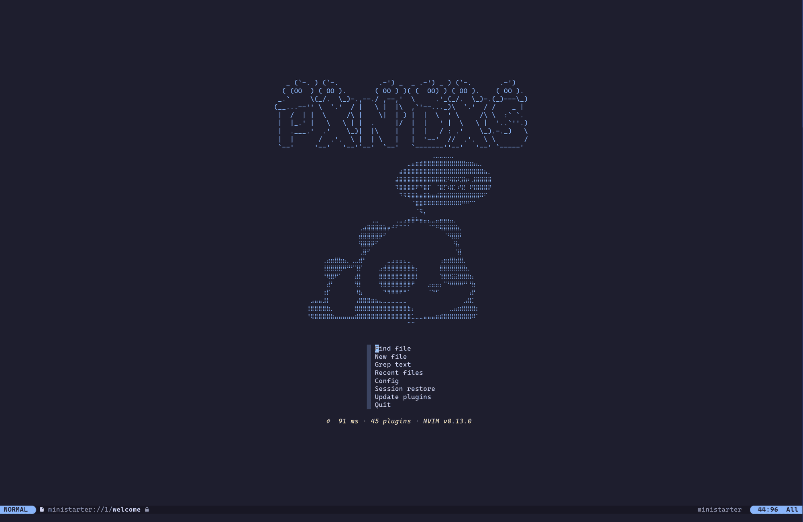
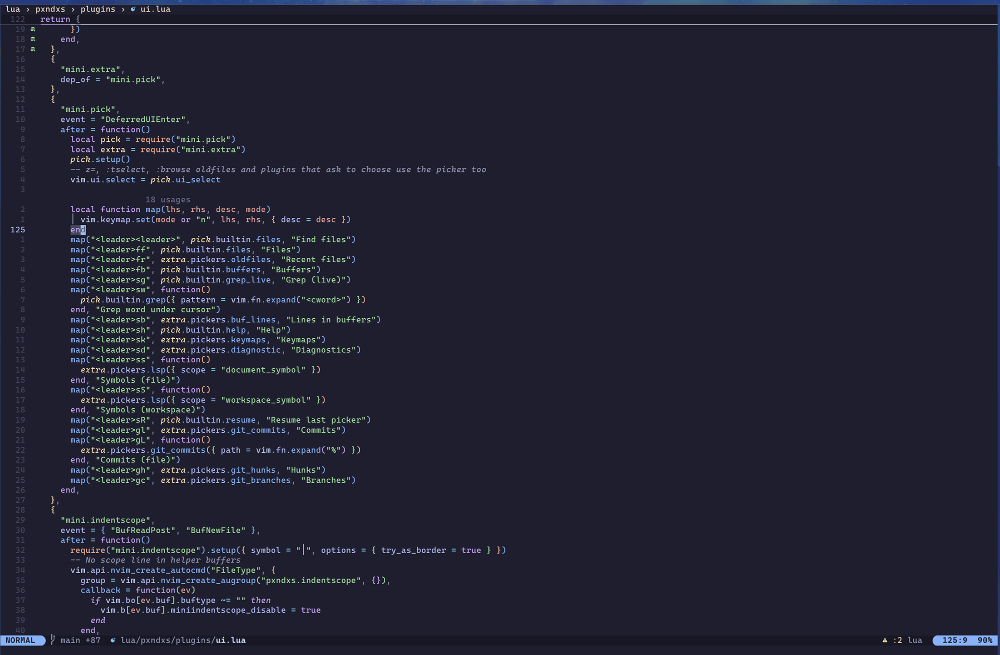

# neopanda 🐼

**English** · [Español](README.es.md)

A Neovim **nightly (0.13)** config that uses what Neovim already ships — LSP client, completion, snippets,
treesitter, statusline, sessions, multicursor — and adds a plugin only where nothing native exists. Plugins are
installed by the built-in `vim.pack` and lazy-loaded with [lze](https://github.com/BirdeeHub/lze); LSP servers are
configured without nvim-lspconfig. Keymaps are designed for a **Dvorak** layout on a 60% keyboard.

It runs as its own app (`NVIM_APPNAME=neopanda`), so it never touches an existing `~/.config/nvim`.
Start it with `npd` (or `neopanda`).





> [!NOTE]
> Nightly only: it uses 0.13 APIs (`vim.pack`, ui2, native multicursor, `:restart`). On a stable release it will not load.

## Features

- **Editing** — native multicursor, surround, pairs, flash jumps, treesitter text objects and split/join, project
  search and replace (grug-far), file management by editing a directory (oil).
- **Find** — mini.pick for files, grep, buffers, help, keymaps, LSP symbols and diagnostics; also `vim.ui.select`.
- **LSP** — 23 servers in `lsp/*.lua`, enabled only when installed; format on save through the server; inlay hints,
  code lens, folding, document highlight; schemas for JSON/YAML.
- **Completion** — native menu while typing, signature above the cursor, friendly-snippets + your own `snippets/`.
- **UI** — michipanda theme, theme picker with live preview, transparency, glass floats, native statusline, tab line, statuscolumn and breadcrumbs, ui2 messages, render-markdown, indent scope.
- **Git** — gitsigns (hunks, blame, word diff), lazygit in a float, pickers for commits and branches, open on GitHub.
- **AI** — Copilot ghost text and next edit suggestions through the native LSP client, Claude Code connected like
  its IDE extension, other AI CLIs (opencode, codex…) in a side terminal.
- **Debug and tests** — nvim-dap + dap-view (JS/TS, Go, Rust, Dart), `.vscode/launch.json`; neotest (Go, Vitest,
  Dart), Rust through `cargo test`.
- **Languages** — databases (dadbod), HTTP requests (`.hurl`), `Cargo.toml` versions, Docker, SQL.
- **Sessions** — one per directory (and git branch), restored when `npd` starts with no file; with no session, a
  start screen (mini.starter) shows the panda and a one-key menu.

## Install

### Nix (Apple Silicon macOS / NixOS / Linux)

No clone. Try it without installing:

```sh
nix run github:pxnditxyr/neopanda
```

Or add the flake to your config and rebuild:

```nix
# flake.nix
inputs.neopanda.url = "github:pxnditxyr/neopanda";

# home-manager (or environment.systemPackages)
home.packages = [ inputs.neopanda.packages.${pkgs.stdenv.hostPlatform.system}.default ];
```

Then open `npd`. On the first start it downloads the plugins and builds the parsers by itself, about a minute with no
questions, so it needs network once. If it can't download them, it retries on the next start.

The `npd` wrapper puts everything the config needs on `PATH`: git, ripgrep, fd, lazygit, tree-sitter, the LSP
servers (including Copilot's, the only unfree package), debug adapters, hurl, jq and database clients. The config
itself is inside `npd` too, read-only in the Nix store; the plugins' lockfile is a writable copy in
`~/.local/state/neopanda`.

To change the config, clone the repo and point `npd` at it. Lua edits apply on the next start, with no rebuild, and
`:packupdate` writes the repo's lockfile:

```sh
NEOPANDA_CONFIG=~/dev/neopanda npd
```

### Ubuntu / WSL2 (no Nix)

```sh
git clone https://github.com/pxnditxyr/neopanda ~/dev/neopanda
~/dev/neopanda/scripts/bootstrap.sh --dry-run   # preview
~/dev/neopanda/scripts/bootstrap.sh
```

The script is safe to re-run. It:

- installs `git ripgrep fd-find build-essential curl unzip xz-utils xclip inotify-tools python3-venv libxml2 jq
  postgresql-client sqlite3 mariadb-client` with apt and links `fd` → `fdfind`;
- installs [bob](https://github.com/MordechaiHadad/bob) from a checksum-verified release, then Neovim nightly;
- installs tree-sitter, lazygit and hurl from checksum-verified releases into `~/.local/bin`, and Claude Code with
  its official installer;
- keeps Node 22+ if present, else installs a checksum-verified Node 26 into `~/.local` (Mason needs it);
- moves an existing `~/.config/neopanda` (and its data, state and cache) to `*.bak.<timestamp>`;
- links `~/.config/neopanda` to the clone;
- adds `PATH` and `alias npd='NVIM_APPNAME=neopanda nvim'` to `~/.bashrc` / `~/.zshrc`.

On the first start, Mason installs the LSP servers and debug adapters (`:Mason` to watch, `ZR` when it is done).
Not in Mason: nixd (Nix only) and rust-analyzer (`rustup component add rust-analyzer`). On WSL2 the clipboard works
through WSLg with `xclip`.

### Uninstall

```sh
rm -rf ~/.config/neopanda ~/.local/share/neopanda ~/.local/state/neopanda ~/.cache/neopanda
```

Then remove the `# neopanda` block from your shell rc (bootstrap) or the package from your Nix config.

## Usage

Leader is `<Space>`; `<Space>` alone waits and shows the next keys (mini.clue). Only maps that nightly does not
already provide are listed: `gr*` (LSP), `]d` `]q` `]b`…, `an`/`in`, `al`/`il`, `gc` (comment), `K` and `ZR` stay
native.

### General

| Key | Description | Mode |
|---|---|---|
| `<Esc>` | Clear search highlight | n |
| `n` / `N` | Next / previous match, centered | n |
| `J` | Join lines keeping the cursor | n |
| `<` / `>` | Indent and keep the selection | x |
| `<A-j>` / `<A-k>` | Move line / selection down / up | n x |
| `[<Space>` / `]<Space>` | Add an empty line above / below | n |
| `gs` / `gS` | Next / previous misspelled word | n x o |
| `<leader>w` / `<leader>z` | Write / close window | n |
| `<C-h>` `<C-j>` `<C-k>` | Window left / down / up (`<C-l>` stays native: redraw, clears multicursors) | n |
| `<C-Arrows>` | Resize window | n |
| `<leader><Tab>n` | New tab (`gt` / `gT` to switch) | n |
| `<leader>uu` | Toggle undotree | n |
| `<leader>ud` / `<leader>uv` | Toggle diagnostics / diagnostic virtual lines | n |
| `<leader>uc` | Pick a theme: moving previews it, `<CR>` keeps it, `<Esc>` restores the previous one | n |
| `<leader>uT` | Toggle transparency | n |
| `<leader>ug` | Toggle glass floats (no background) | n |
| `<C-q>` | Leave a terminal (Claude, lazygit, `:terminal`) for the previous window | t |

Native multicursor: `Q` adds or removes a cursor, `zq{motion}` puts one at every target (`zqgn` = every match),
`<C-l>` clears them and `gQ` restores them. Other native commands: `:Undotree`, `:DiffTool {left} {right}` (files or
directories), `:Cfilter`, `ZR` (restart keeping the session).

### Editing

| Key | Description | Mode |
|---|---|---|
| `ys{motion}{char}` / `yss` / `S` | Surround: add around a motion / the line / the selection | n / n / x |
| `ds{char}` / `cs{old}{new}` | Surround: delete / replace | n |
| `s` / `S` | Flash jump / treesitter selection (`r` in operator-pending: remote) | n x o / n o |
| `af` `ac` `aa` (and `i…`) | Function / class / argument text objects (treesitter) | x o |
| `]f` `[f` `]a` `[a` (`]F` `]A`…) | Next / previous function or argument start (end) | n x o |
| `ai` / `ii` | Indent scope text object (with / without border) | x o |
| `<leader>j` | Split / join the node under the cursor (treesj) | n |
| `-` / `_` | Parent directory (native browser) / edit it with oil: rename, create, delete | n |
| `<leader>sr` | Search and replace in the project (grug-far) | n x |
| `<C-t>` / `<C-d>` | Snippet: next / previous field (outside a snippet: native indent / dedent) | i s |

mini.ai also adds `a`/`i` objects for brackets, quotes, tags and `?` that reach the next match. `TODO` `FIXME`
`HACK` `NOTE` and `#rrggbb` colors are highlighted.

### Find

| Key | Description | Mode |
|---|---|---|
| `<leader><leader>` / `<leader>ff` | Find files | n |
| `<leader>fr` / `<leader>fb` | Recent files / buffers | n |
| `<leader>sg` / `<leader>sw` / `<leader>sb` | Grep live / word under the cursor / lines in buffers | n |
| `<leader>ss` / `<leader>sS` | LSP symbols in the file / workspace | n |
| `<leader>sd` / `<leader>sh` / `<leader>sk` | Diagnostics / help / keymaps | n |
| `<leader>sR` | Resume the last picker | n |

### LSP, formatting and completion

Server configs are self-contained in `lsp/*.lua` and only enabled when their binary is on `PATH`: emmylua_ls, nixd,
vtsls, basedpyright, ruff, bashls, jsonls, yamlls, taplo, marksman, rust_analyzer, gopls, vue_ls, svelte, astro,
html, cssls, tailwindcss, eslint, biome, sqls, docker_language_server and copilot. tailwindcss, eslint, biome and
sqls start only in projects that use them. Dart/Flutter: flutter-tools.nvim starts dartls from the Flutter SDK.

| Key | Description | Mode |
|---|---|---|
| `gd` / `gD` | Definition / declaration | n |
| `gra` `grn` `grr` `gri` `grt` `gO` `K` | Native: code action, rename, references, implementation, type, symbols, hover | n |
| `<C-s>` | Signature help | i |
| `<C-y>` / `<C-e>` | Accept / cancel the completion menu | i |
| `<leader>uf` / `<leader>uF` | Toggle format on save (all / this buffer) | n |
| `<leader>uh` | Toggle inlay hints | n |
| `<leader>uS` | Toggle snippets in the completion menu | n |
| `<leader>lr` / `<leader>li` | Restart the servers / info (`:checkhealth vim.lsp`) | n |

The menu opens while typing (also for `:`, `/` and `?`); servers are asked after a letter or one of their trigger
characters. The signature pops up above the cursor after `(` and `,` and stays while the cursor is inside the call.
Snippets come from friendly-snippets and `snippets/` (VS Code JSON, one file per language), ranked with the rest.
Saving formats through the buffer's server (biome when the project has `biome.json`); Markdown is not formatted.

### Git

gitsigns marks changed lines on the right of the numbers and fills the statusline git slot. lazygit runs in a
floating terminal: `e` on a file opens it in this Neovim. `]c` / `[c` move between changes in diff mode.

<details>
<summary>Git keys</summary>

| Key | Description | Mode |
|---|---|---|
| `]h` / `[h` / `]H` / `[H` | Next / previous / last / first hunk (`ih`: hunk text object) | n |
| `<leader>gs` / `<leader>gr` | Stage (toggle) / reset the hunk or the selected lines | n x |
| `<leader>gS` / `<leader>gR` | Stage / reset the buffer | n |
| `<leader>gp` / `<leader>gd` | Preview the hunk inline / diff this file | n |
| `<leader>gb` | Blame the line | n |
| `<leader>ub` / `<leader>uw` | Toggle line blame / word diff | n |
| `<leader>gg` | lazygit | n |
| `<leader>gl` / `<leader>gL` / `<leader>gh` / `<leader>gc` | Pick commits / file commits / hunks / branches | n |
| `<leader>go` | Open the file (line or selection) on GitHub / GitLab | n x |

</details>

### AI

| Key | Description | Mode |
|---|---|---|
| `<Tab>` | Accept the suggestion (else next snippet field, else Tab) | i |
| `<Tab>` | Jump to / apply the next edit suggestion (NES) | n |
| `<M-n>` / `<M-p>` | Next / previous suggestion | i |
| `<leader>ua` | Toggle suggestions | n |
| `<leader>cc` / `<leader>cf` / `<leader>cm` | Claude Code: toggle / focus / model | n |
| `<leader>cs` | Claude Code: add the file / send the selection | n / x |
| `<leader>cy` / `<leader>cn` | Claude Code: accept / reject the proposed diff (also `:w` / `:q`) | n |
| `<leader>aa` / `<leader>as` | AI CLI: toggle / pick a tool | n |
| `<leader>at` / `<leader>af` / `<leader>ap` | AI CLI: send this (line or selection) / the file / a prompt | n x / n / n x |
| `<C-.>` | AI CLI: focus | n x i t |

#### AI: usage

- **Sign in once** to Copilot with `:LspCopilotSignIn`. Off Nix, Mason installs `copilot-language-server`.
- **Ghost text** — type; a grey suggestion appears. `<Tab>` accepts it, `<M-n>` / `<M-p>` cycle the alternatives,
  keep typing to ignore it. `<leader>ua` turns suggestions off (for example in a talk).
- **Next edit suggestion** — after you change something, leave Insert mode: if Copilot predicts the next edit
  elsewhere, `<Tab>` in Normal mode jumps there; `<Tab>` again applies it.
- **Claude Code** — `<leader>cc` opens Claude in a side terminal, connected like its VS Code extension. Select code
  and `<leader>cs` to send it ("explain this", "add tests for this"). When Claude edits a file, the change opens as a
  diff: `<leader>cy` (or `:w`) accepts, `<leader>cn` (or `:q`) rejects. `claude` + `/ide` in another terminal of the
  same project connects too. `<C-q>` leaves the terminal, `<leader>cf` returns to it.
- **Other AI CLIs** — `<leader>as` picks one (opencode, codex…); `<leader>at` sends the line or selection,
  `<leader>af` the file, `<leader>ap` a ready-made prompt (review, fix diagnostics…); `<C-.>` focuses it.
- **Privacy** — secret files (`.env*`, `*.pem`, `*.key`, `id_*`, `secrets.*`, `.netrc`, `credentials*`) never get
  suggestions.

### Debug and tests

nvim-dap is the debugger client; nvim-dap-view opens a panel (scopes, watches, breakpoints, threads, REPL, console)
when a session starts and shows variable values inline. Adapters: JS/TS (vscode-js-debug), Go (delve), Rust
(lldb-dap, else codelldb) and Dart/Flutter (flutter-tools). A project's `.vscode/launch.json` shows up in
`<leader>dc`. neotest runs Go, Vitest and Dart tests with ✓/✗ beside each one; Rust tests run `cargo test` into the
quickfix list.

<details>
<summary>Debug and test keys</summary>

| Key | Description | Mode |
|---|---|---|
| `<leader>db` / `<leader>dB` | Toggle breakpoint / conditional breakpoint | n |
| `<leader>dc` / `<leader>dC` | Start or continue / run to the cursor | n |
| `<leader>di` / `<leader>dO` / `<leader>do` | Step into / over / out | n |
| `<leader>dl` / `<leader>dt` | Run last / terminate | n |
| `<leader>du` / `<leader>dr` | Toggle the debug view / REPL | n |
| `<leader>de` / `<leader>dw` | Evaluate under the cursor / add to watches | n / n x |
| `<leader>tr` / `<leader>tt` / `<leader>tT` / `<leader>tl` | Test nearest / file / all / last | n |
| `<leader>td` / `<leader>tS` / `<leader>tw` | Debug nearest test / stop / watch the file | n |
| `<leader>ts` / `<leader>to` / `<leader>tO` | Summary / output / output panel | n |

</details>

### Languages

| Key | Description | Mode |
|---|---|---|
| `<leader>D` | Database UI (dadbod) | n |
| `<leader>rs` | `.hurl`: run the request under the cursor (or the selection) | n x |
| `<leader>ra` / `<leader>rv` | `.hurl`: run the whole file / verbose | n |
| `<leader>rm` / `<leader>re` | `.hurl`: toggle split / popup response, pick an env file | n |

Databases: in the DBUI drawer add a connection with `A` (`postgres://user@localhost/db`, `sqlite:path/app.db`); in
its query buffers the completion menu lists the tables and columns first. HTTP: the `.hurl` response opens in a split
(`q` closes), JSON formatted with `jq`, variables from a `vars.env`. `Cargo.toml` gets versions, features and
upgrades from crates.nvim (completion, hover, `gra`); in `go.mod`, gopls' code lens checks for upgrades. Dockerfile,
Compose and Bake files use docker-language-server.

### Sessions

| Key | Description | Mode |
|---|---|---|
| `<leader>qs` / `<leader>qS` / `<leader>ql` | Restore (this directory) / pick / last | n |
| `<leader>qd` / `<leader>qq` | Don't save on exit / quit all | n |

Native `:mksession`. Quitting saves the session of the directory (one per git branch other than main/master);
starting `npd` with no file restores it. `npd file`, stdin and `ZR` neither restore nor save one.
With no session to restore, a start screen (mini.starter) shows the panda and a menu: `f` find file, `n` new file,
`g` grep, `r` recent files, `c` config, `t` themes, `s` session restore, `u` update plugins, `q` quit. The footer shows startup
ms, plugin count and Neovim version. Small windows drop the panda, then the art (`lua/pxndxs/dashboard.lua`).

## Dvorak and 60% keyboard

The keymaps were chosen for Dvorak US on a 60% keyboard (no F keys):

- `[` and `]` sit on the right pinky (number row), so maps where they are followed by another right-pinky key (`s`,
  `l`, `z`, `-`, `/`) are avoided: `gs` / `gS` replace `]s` / `[s`.
- Prefixes are mnemonic and spread over both hands: `<leader>f` find, `s` search, `g` git, `d` debug, `t` tests,
  `c` Claude, `a` AI CLIs, `u` toggles, `q` sessions, `r` requests.
- `hjkl` stay: there is no evidence that remapping them helps on Dvorak, and every plugin expects them.
- No F keys: debugging uses `<leader>d*` instead of VS Code's F5 / F10 / F11.

## Settings

Per-machine overrides go in `~/.config/neopanda/lua/pxndxs/settings_local.lua` (gitignored in a clone), merged over the
defaults:

```lua
return {
  ui2 = true,        -- experimental message/cmdline UI
  autoformat = true, -- format on save (toggle: <leader>uf, buffer: <leader>uF)
  nerd_font = true,  -- Nerd Font icons (signs, statusline, completion, DBUI); false = plain text
  transparent = true, -- terminal background behind the editor, until toggled with <leader>uT
}
```

> [!WARNING]
> ui2 is an internal, experimental Neovim module. If messages or prompts misbehave after a nightly update, set
> `ui2 = false`.

## Updating

Plugins are pinned in `nvim-pack-lock.json` — commit it. With Nix, a new pinned lockfile moves your plugins to it on the
next start, replacing what a local `:packupdate` did.

| Task | How |
|---|---|
| Update plugins | `:packupdate` → review → `:w` to apply, `:q` to cancel; in a clone, commit the lockfile |
| Revert (clone) | `git checkout -- nvim-pack-lock.json`, then `:packupdate ++lockfile` |
| Remove a plugin | Delete its line in `lua/pxndxs/pack.lua`, `ZR`, `:packdel ++all` |
| New machine | Start `npd`: the locked revisions install on the first start |
| Update neopanda, Neovim and tools (Nix) | `nix flake update neopanda` in your config, then rebuild |

Build steps (e.g. `:TSUpdate`) go in the `build` table of `lua/pxndxs/pack.lua`.

## Health and troubleshooting

- `:checkhealth neopanda` — Neovim version, environment, settings, tools, LSP servers, debug adapters and plugins.
- `nix develop -c scripts/smoke-test.sh` — headless load, health errors, `bash -n`, shellcheck and stylua.
- `scripts/test-install.sh` — builds `npd` and runs it on empty dirs: first start, offline start, new pinned lockfile and
  failed downloads. Needs network.
- `.github/workflows/ci.yml` — the same checks plus the Ubuntu bootstrap. Manual only (Actions → CI → Run workflow).
- Linux: servers learn about new files through `inotifywait`. Keep WSL projects under `~` (not `/mnt/c`), and raise
  `fs.inotify.max_user_watches` with sysctl if you see "no space left on device".

### Startup time

Measured with no file on a MacBook Air: **~49 ms** on an idle machine (average of 10 runs), **~90 ms** under normal
desktop load. Measure with `rm -f /tmp/st.log; npd --startuptime /tmp/st.log`, `:qa`, then
`grep 'NVIM STARTED' /tmp/st.log`: the TUI writes two lines (UI client and server); the larger one is the config.

Where the time goes: `vim.pack.add` + lze reading the plugin specs (~30 ms under load), resolving the `lsp/*.lua`
configs to enable only installed servers (~12 ms), and Neovim's own startup (runtime, ShaDa, UI attach). The first
start after editing a Lua file is slower (`vim.loader` recompiles it). Deferring the LSP setup would save ~12 ms; not
done, as the gain does not justify the risk to buffers opened at startup.

## Development

```sh
nix develop          # stylua, shellcheck, lua-language-server, nixd
nix flake check
nix build            # ./result/bin/npd
```

Layout: `init.lua` loads the native modules in `lua/pxndxs/` (options, keymaps, LSP, completion, statusline…), then
`lua/pxndxs/pack.lua` installs the plugins and lze loads their specs from `lua/pxndxs/plugins/<area>.lua`. Server
configs live in `lsp/`, the health check in `lua/neopanda/health.lua`.

`colors/michipanda.lua` is generated: change the palette in `scripts/gen-michipanda.lua`, then run
`nvim --clean -l scripts/gen-michipanda.lua`.

`lsp/*.lua` files are based on [nvim-lspconfig](https://github.com/neovim/nvim-lspconfig) (Apache-2.0).
